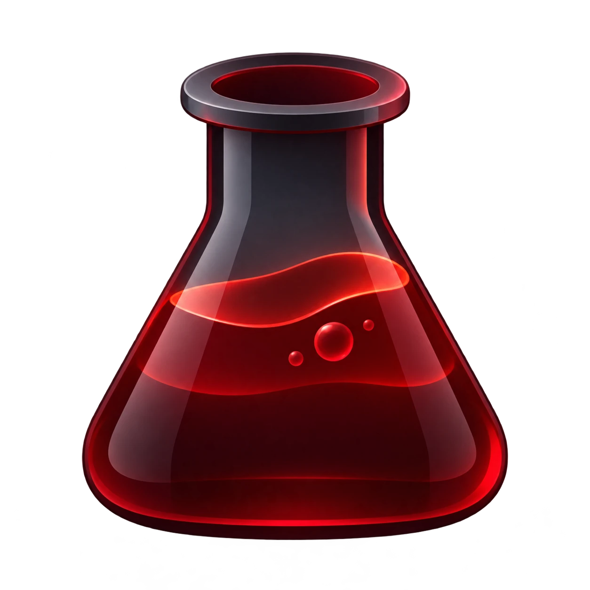

<p align="center"></p>

# openLab

openLab is an open-source show-playback system for theatre, in the spirit of QLab 5. A headless Rust engine owns the
show, timing and audio; a native Swift/AppKit app on macOS is the operator interface, so a UI fault never stops
playback. See [`REQUIREMENTS.md`](REQUIREMENTS.md) and the skills in `.claude/skills/` (architecture and behaviour); open work is in
GitHub issues and milestones.

## Installing

openLab is not signed or notarized (that needs a paid developer account), so macOS blocks it the first time you open it. Only continue if the disk image came from this project's release page on GitHub.

1. Open the `.dmg` and drag the openLab app onto the Applications shortcut. Eject the disk image.
2. Open Applications and double-click openLab. macOS says it cannot verify the app; choose Done (or OK).
3. Right-click (or Control-click) the app and choose Open, then Open again in the box that appears. If there is no Open button in that box, go to System Settings, Privacy & Security, scroll to Security, and choose Open Anyway next to the openLab message, then confirm.
4. From then on openLab opens with a normal double-click.

The exact wording differs a little between macOS versions. The disk image also holds the GPL licence and the notices for the third-party components openLab includes (`THIRD-PARTY-NOTICES.txt`, regenerated with `scripts/third-party-notices.py generate`).

## Using and contributing

- [Getting started](docs/getting-started.md): a first show, the cue types, Show Mode and a show-day checklist.
- [OSC reference](docs/osc.md): controlling openLab from remotes, desks and scripts.
- [Contributing](CONTRIBUTING.md): how the code is laid out, the rules and the tests.

## Licence

GNU General Public License v3.0 or later. See [`LICENSE`](LICENSE).

## Building

Prerequisites (macOS 12 or later to run; building needs a Mac with Xcode):

- [rustup](https://rustup.rs) — the pinned toolchain in `engine/rust-toolchain.toml` installs automatically
- Xcode 27.x
- [XcodeGen](https://github.com/yonaskolb/XcodeGen): `brew install xcodegen`
- For development: `rustup toolchain install nightly`, `cargo install cargo-fuzz cargo-deny`

```
make lint        # SPDX headers, cargo fmt --check, clippy -D warnings, cargo deny, swift format lint
make test        # all Rust tests + macOS unit tests and the UI smoke set
make test-rust   # Rust tests only (also works on Windows with cargo)
make test-mac    # generate the Xcode project and run macOS unit tests + the UI smoke set (scripts/ui-smoke.txt); CI runs the same tests as two parallel shards (`make test-mac-shard SHARD=1`, 2)
make test-mac-ui-full  # the same with every UI test (run nightly in CI, minus scripts/ui-local-only.txt)
make mac         # build the Release app with a universal engine: build/Build/Products/Release/openLab.app
make verify-bundle  # check that app: universal, macOS 12.0 minimum on every slice, one version, icon, valid signature
make dmg         # the release disk image from that app: build/openLab-<version>.dmg (app, Applications link, LICENSE.txt, THIRD-PARTY-NOTICES.txt)
make test-bundle-rebuild  # check an engine-only rebuild still gives a validly signed app (slow; run nightly in CI)
```

The Xcode project is generated from `mac/project.yml` and is not committed; run `cd mac && xcodegen` to open it in
Xcode. UI tests need macOS Automation Mode; Xcode asks for authorisation the first time they run.
